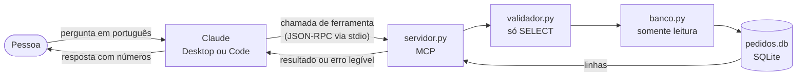

# Servidor MCP de Pedidos

Servidor [MCP](https://modelcontextprotocol.io) em Python que conecta o Claude
a um banco SQLite de pedidos de delivery (dados fictícios). Com ele, é possível
perguntar em português, no Claude Desktop ou no Claude Code, coisas como "qual o
ticket médio por bairro?" e receber a resposta calculada a partir dos dados.

## 1. O problema

Quem é de negócio depende de alguém que saiba SQL para responder perguntas
simples sobre os dados, e cada pergunta vira um pedido na fila do time de dados.
Este projeto deixa o Claude escrever e executar essas consultas com segurança,
mostrando como chegou a cada número.

## 2. Demonstração

<!-- TODO: capturas do Claude Desktop respondendo com o servidor conectado -->
_Capturas de tela em breve._

Dez perguntas reais, da simples à difícil, com as ferramentas chamadas, o SQL
gerado e as respostas, estão em [`exemplos/perguntas.md`](exemplos/perguntas.md).
Um trecho:

> **Como outubro se compara com setembro?**
>
> Outubro foi maior em volume e praticamente igual em qualidade. Por dia, o
> crescimento foi de 52,3 para 56,9 pedidos (+8,7%), já que outubro tem um dia a mais.
>
> | Métrica | Setembro | Outubro | Variação |
> |---|---|---|---|
> | Pedidos | 1.569 | 1.763 | +12,4% |
> | Faturamento | R$ 115.673,32 | R$ 129.437,36 | +11,9% |
> | Ticket médio | R$ 77,89 | R$ 77,18 | −0,9% |

## 3. O que é MCP

O Model Context Protocol é um padrão aberto para conectar aplicativos de IA a
dados e ferramentas externas. Um **servidor MCP** publica **ferramentas**: cada
uma tem nome, uma descrição em texto e um esquema de entrada em JSON Schema. O
**host** (Claude Desktop, Claude Code ou outro aplicativo compatível) lê essas
descrições, e o modelo decide quando chamar cada ferramenta e com quais
argumentos. Aqui o transporte é **stdio**: o host inicia o servidor como um
processo local e os dois trocam mensagens JSON-RPC pela entrada e saída padrão,
sem rede. Como o protocolo é padrão, o mesmo servidor funciona em qualquer host
compatível, sem integração específica.



## 4. Ferramentas

| Ferramenta | O que faz |
|---|---|
| `listar_tabelas` | Tabelas do banco, com descrição e número de linhas. |
| `descrever_tabela` | Colunas de uma tabela: tipo, significado, nulos, chaves e exemplos de valores. Para colunas de texto com poucos valores (status, bairro, categoria), lista todos os valores possíveis. |
| `consultar` | Executa um `SELECT` e devolve as linhas (até 200, com aviso quando o resultado é cortado). |
| `resumo_periodo` | Métricas prontas de um período: pedidos, faturamento, ticket médio, tempo médio de entrega, nota média e taxa de cancelamento. |

O servidor envia ao Claude, na conexão, instruções com o fluxo sugerido: usar
`resumo_periodo` para as métricas padrão e, para o resto, descrever as tabelas
antes de escrever SQL em `consultar`.

Algumas decisões de design:

- **As descrições são o prompt.** É a descrição de cada ferramenta e coluna que
  o Claude lê para decidir o que fazer. Por isso elas trazem as regras de
  negócio (`valor_total` já inclui a taxa de entrega; cancelados não têm tempo
  nem nota) e as armadilhas do dialeto (o SQLite não tem `DATE_TRUNC` nem
  `EXTRACT`).
- **As definições das métricas estão escritas.** Em `resumo_periodo`, o
  faturamento só conta pedidos entregues, e o ticket médio é o faturamento
  dividido pelos pedidos entregues. Uma ferramenta pronta para a pergunta mais
  comum dá sempre o mesmo número, sem depender do SQL que o modelo escrever.
- **Entrada restrita pelo esquema.** `descrever_tabela` aceita só os quatro
  nomes de tabela (`enum` no esquema), e um nome inválido é recusado antes de
  chegar ao código.
- **Saída estruturada.** Os retornos são tipados (`TypedDict`), e o servidor
  publica um esquema de saída, além do texto JSON.
- **Ajustes vindos do uso real.** No primeiro teste, o Claude chamou o parâmetro
  de `descrever_tabela` de `tabela`, e não de `nome`, como ele se chamava. O
  parâmetro foi renomeado para o nome que o modelo usa por conta própria.

## 5. Segurança

Toda consulta passa por três camadas independentes, de modo que, se uma falhar,
as outras seguram:

1. **Validação do texto (`validador.py`).** Aceita só um comando, começando com
   `SELECT` ou `WITH`. Percorre o SQL respeitando aspas e comentários, então
   recusa `/* SELECT */ DELETE ...` e `SELECT 1; DROP TABLE ...`, mas aceita
   `WHERE status = 'DELETE'`. Recusa também `WITH x AS (...) DELETE ...`, que é
   válido no SQLite e passaria por um filtro que só olhasse a primeira palavra.
2. **Conexão somente leitura (`mode=ro`).** O próprio SQLite recusa qualquer
   escrita no arquivo.
3. **Authorizer do SQLite.** É uma função que o SQLite chama para cada operação
   ao preparar o comando. Ela libera apenas leitura de tabelas e chamada de
   funções, e nega `ATTACH`, `PRAGMA`, escrita e `load_extension` dentro do
   motor.

Além disso, cada consulta tem limite de **200 linhas** e **5 segundos**
(interrompida pelo `progress_handler` do SQLite). Os erros voltam ao Claude com
uma mensagem legível, inclusive a do SQLite (por exemplo, `no such column:
valor`), para ele corrigir a consulta e tentar de novo.

Os testes provam cada camada **separadamente**: executam comandos de escrita
direto na conexão, sem o validador, e mostram que o authorizer recusa; depois
desligam o authorizer e mostram que o `mode=ro` ainda bloqueia.

Os dados são inteiramente fictícios: cidade, bairros e restaurantes inventados,
e clientes sem nome nem dado pessoal.

## 6. Exemplos

Em [`exemplos/perguntas.md`](exemplos/perguntas.md) estão 10 perguntas feitas no
Claude Desktop. Para cada uma há as ferramentas chamadas, o SQL exato (tirado do
log do servidor) e a resposta sem edição:

1. Quantos pedidos tivemos em outubro?
2. Como outubro se compara com setembro?
3. Qual o ticket médio por bairro?
4. Quais restaurantes têm o maior tempo de entrega e a pior nota?
5. A taxa de cancelamento piora em algum horário?
6. Fim de semana vende mais que dia útil? E o ticket muda?
7. Quais são os 5 itens mais vendidos e de que categoria são?
8. Qual foi a semana com mais pedidos?
9. Os bairros com entrega mais lenta também têm as piores notas?
10. Clientes que se cadastraram durante o período pedem mais ou menos que os antigos?

Cada número das respostas foi conferido com o resultado das ferramentas. O
arquivo também registra a imprecisão encontrada e um caso real de erro e
correção.

## 7. Limitações e próximos passos

**Limitações**

- Os dados são fictícios e pequenos (5.000 pedidos em 3 meses). Os padrões foram
  colocados de propósito pelo gerador.
- O servidor é local (stdio) e de um só usuário, sem autenticação.
- O validador é conservador: recusa qualquer palavra proibida fora de aspas,
  mesmo onde ela seria inofensiva.
- O limite de 200 linhas obriga a agregar no SQL. Isso é intencional, mas
  impede exportar dados brutos.
- O modelo ainda pode interpretar mal uma pergunta ou arredondar uma conclusão.
  Os exemplos mostram um caso. Por isso as respostas citam o critério usado e o
  SQL fica registrado.
- O log de chamadas (`logs/chamadas.jsonl`) guarda os resultados completos.
  Com dados reais, isso precisaria de política de retenção.

**Próximos passos**

- Transporte Streamable HTTP, para usar o servidor remotamente, com autenticação.
- PostgreSQL com um usuário de banco somente leitura, como quarta camada.
- Recursos (resources) e prompts do MCP, por exemplo um dicionário de dados
  como recurso.
- Avaliação automática: rodar as perguntas de exemplo contra o servidor e
  comparar com respostas esperadas a cada mudança nas descrições.

## 8. Como instalar e conectar

Pré-requisitos: [uv](https://docs.astral.sh/uv/) e Python 3.11+ (o uv pode
instalar com `uv python install 3.12`).

```bash
git clone https://github.com/lgthebaldi/mcp-pedidos.git
cd mcp-pedidos
uv sync                            # cria o .venv com o SDK mcp e o pytest
uv run python src/gerar_dados.py   # gera data/pedidos.db (semente fixa)
uv run pytest                      # 78 testes
```

### Claude Code

O repositório já traz o `.mcp.json`, que registra o servidor no escopo de
projeto. Abra o Claude Code na pasta (`claude`) e aprove o servidor `pedidos`
quando ele pedir. Por segurança, o Claude Code pede aprovação antes de ativar
servidores definidos no repositório. Confira com `/mcp` ou `claude mcp list`.

O `.mcp.json` usa `${CLAUDE_PROJECT_DIR:-.}`, então não depende de onde o
projeto foi clonado. Para registrar em outro escopo:

```bash
claude mcp add --scope user --transport stdio pedidos -- \
  uv run --directory /caminho/para/mcp-pedidos python src/servidor.py
```

### Claude Desktop

Com o Claude Desktop **totalmente fechado** (não só a janela), adicione a chave
`mcpServers` ao arquivo de configuração:

| Sistema | Arquivo |
|---|---|
| Linux | `~/.config/Claude/claude_desktop_config.json` |
| macOS | `~/Library/Application Support/Claude/claude_desktop_config.json` |
| Windows | `%APPDATA%\Claude\claude_desktop_config.json` |

```json
{
  "mcpServers": {
    "pedidos": {
      "command": "/caminho/absoluto/para/uv",
      "args": ["run", "--directory", "/caminho/absoluto/para/mcp-pedidos",
               "python", "src/servidor.py"]
    }
  }
}
```

Os caminhos precisam ser absolutos (`which uv` mostra o do uv), porque o Desktop
não herda o PATH do terminal. Reabra o Desktop e confira em **+ → Connectors →
Manage connectors**. Se o servidor não aparecer, os logs ficam em
`~/.config/Claude/logs/mcp*.log` (Linux).

### Variáveis de ambiente

| Variável | Padrão | Uso |
|---|---|---|
| `MCP_PEDIDOS_DB` | `data/pedidos.db` | Caminho do banco. |
| `MCP_PEDIDOS_LOG` | `logs/chamadas.jsonl` | Log de chamadas; vazio desliga. |

### Estrutura

```
src/gerar_dados.py   gera o banco fictício (30 restaurantes, 500 clientes, 5.000 pedidos)
src/validador.py     camada 1: só um SELECT por chamada
src/banco.py         camadas 2 e 3, limites, documentação das colunas, métricas
src/servidor.py      servidor MCP e as quatro ferramentas
tests/               validador, banco e servidor (cliente MCP em memória e via stdio)
exemplos/            perguntas reais e o log da sessão
```

## 9. Como foi construído

<!-- RASCUNHO: revisar antes de publicar; é a narrativa do autor -->

O projeto foi construído com o **Claude Code**, em etapas pequenas, com um
commit por etapa. Antes de cada etapa, o Claude Code explicava o plano, e eu
aprovava ou ajustava. As regras do trabalho ficaram em [`CLAUDE.md`](CLAUDE.md).

**O que eu decidi**

- O problema, o escopo, a stack e a ordem de construção (`CLAUDE.md`).
- As definições de negócio das métricas: faturamento e ticket médio só com
  pedidos entregues; tempo e nota só com entregues; taxa de cancelamento sobre
  o total.
- Aceitar `WITH ... SELECT` (CTEs) além de `SELECT`, por ser leitura pura e
  útil para perguntas mais difíceis.
- Registrar o servidor no escopo de projeto do Claude Code, com o `.mcp.json`
  versionado.
- Exigir que os exemplos venham de execuções reais e sejam conferidos, o que
  levou ao log de chamadas no servidor.
- Fazer as perguntas de exemplo numa única conversa, registrando o efeito disso
  nos exemplos.

**O que deleguei ao Claude Code**

- A escrita do código e dos testes, a partir do plano aprovado.
- A consulta à documentação atual do SDK `mcp` 2.x (que mudou a API em relação
  à 1.x, como `FastMCP` → `MCPServer`), do Claude Code e do Claude Desktop, antes
  de usar qualquer função.
- A modelagem dos dados fictícios com padrões realistas e a conferência deles
  com consultas manuais.
- A conferência de cada número dos exemplos contra o log do servidor.

**O que o processo ensinou**

- Testar com o modelo real revela problemas que o código não mostra, como o
  nome do parâmetro que o Claude esperava.
- Descrição de ferramenta é trabalho de prompt. As regras escritas nela
  (filtrar entregues, não usar `DATE_TRUNC`) apareceram no SQL que o Claude
  gerou.
